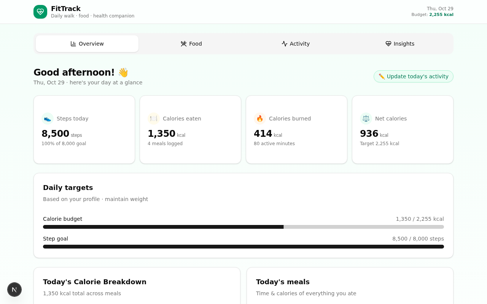
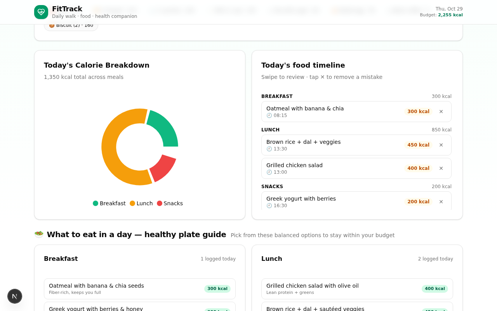
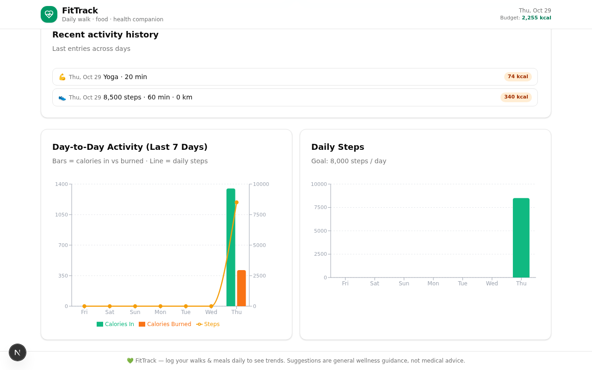
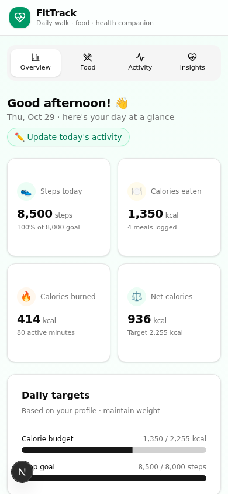

# 🏃 FitTrack — Daily Walk, Food & Health Tracker

A beautiful, mobile-first health tracker that helps you log your **daily walks**, **meals with time & calories**, and get **personalized diet & exercise suggestions** — with a live calorie pie chart and day-to-day activity graphs.


## ✨ Features

- **📊 Live dashboard** — steps, calories eaten/burned, net calories, and goal progress at a glance
- **🍽️ Food logging** — record what you ate, at what time, with how many calories; grouped into breakfast / lunch / dinner / snacks
- **🥧 Calorie pie chart** — watch your meal breakdown update instantly as you log or remove food
- **👟 Walk tracking** — enter steps and get automatic distance (~0.76 m stride) and calorie (~0.04 kcal/step) estimates; enter distance manually to override
- **💪 Exercise tracking** — 10 workout types with MET-based calorie burn estimated from your body weight
- **📈 Day-to-day graphs** — 7-day combined chart of calories in vs. burned (bars) and daily steps (line), plus a steps goal chart
- **🥑 Smart diet suggestions** — "what should you eat next?" adapts to your remaining calorie budget, time of day, and logged meals
- **🎯 Personalized targets** — Mifflin-St Jeor BMR → daily calorie budget, BMI, and exercise plan tuned to your goal (lose / maintain / gain)
- **💡 Health tips** — a rotating tip of the day plus 10 practical habit tips
- **📱 Fully responsive** — optimized layouts for both mobile and laptop screens

## 📸 Screenshots

| Dashboard | Food log & calorie pie chart |
| --- | --- |
|  |  |

| Activity graphs | Mobile view |
| --- | --- |
|  |  |

## 🛠️ Tech Stack

| Layer | Technology |
| --- | --- |
| Framework | Next.js 16 (App Router) + TypeScript 5 |
| UI | Tailwind CSS 4 · shadcn/ui · Lucide icons |
| Charts | Recharts (pie, composed bar + line) |
| Database | SQLite via Prisma ORM |
| State | React hooks + fetch, Zustand-ready |

## 🚀 Getting Started

**Prerequisites:** [Node.js 20+](https://nodejs.org) and [Bun](https://bun.sh) (or npm/pnpm).

```bash
# 1. Clone
git clone https://github.com/sthesikha-cell/healthtracker.git
cd healthtracker

# 2. Install dependencies
bun install

# 3. Configure environment
cp .env.example .env
mkdir -p db

# 4. Create the database
bun run db:push

# 5. Start the dev server
bun run dev
```

Open **http://localhost:3000** and start tracking! Set up your profile in the **Insights** tab to personalize calorie targets.

## 🗂️ Project Structure

```
src/
├── app/
│   ├── api/
│   │   ├── foods/          # GET / POST food entries
│   │   ├── walks/          # GET / POST walk entries
│   │   ├── activities/     # GET / POST exercise entries
│   │   ├── entries/[id]/   # DELETE any entry (?type=food|walk|activity)
│   │   └── summary/        # Aggregated today + last-7-days stats
│   ├── layout.tsx
│   └── page.tsx            # Single-page app with 4 tabs
├── components/health/      # Dashboard, FoodLogger, ActivityTracker, Insights, charts
├── hooks/                  # useHealthData (fetch + refresh), useProfile (localStorage)
└── lib/
    ├── db.ts               # Prisma client
    └── health.ts           # Calorie math, MET table, food DB, tips
prisma/schema.prisma        # FoodEntry · WalkEntry · ActivityEntry
```

## 🔌 API Reference

| Method | Endpoint | Description |
| --- | --- | --- |
| `GET` | `/api/summary` | Today's stats, meal breakdown, 7-day history |
| `GET/POST` | `/api/foods` | List (`?date=YYYY-MM-DD`) / create food entry |
| `GET/POST` | `/api/walks` | List / create walk (auto-estimates distance & kcal) |
| `GET/POST` | `/api/activities` | List / create exercise entry |
| `DELETE` | `/api/entries/:id?type=` | Remove a food, walk, or activity entry |

## 🧮 How the estimates work

- **Steps → calories:** `steps × 0.04 kcal` (≈ 70 kg adult)
- **Steps → distance:** `steps × 0.000762 km` (≈ 0.76 m stride)
- **Exercise calories:** `MET × 3.5 × weight(kg) ÷ 200 × minutes`
- **Daily calorie target:** Mifflin-St Jeor BMR × activity factor, adjusted ±300 kcal for your goal

## 🔮 Roadmap

- [ ] 🌙 Dark mode
- [ ] 💧 Water intake tracking
- [ ] 🔐 Multi-user accounts (NextAuth)
- [ ] 📤 CSV / JSON data export
- [ ] 🏆 Weekly goals & streaks

---

> 💚 **Disclaimer:** FitTrack offers general wellness guidance only — not medical advice. Consult a professional before changing your diet or exercise routine.
